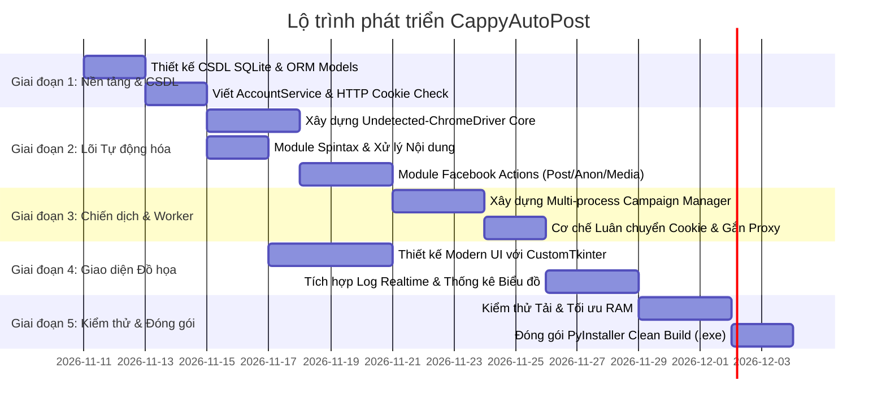

# KẾ HOẠCH PHÁT TRIỂN DỰ ÁN: CAPPYAUTOPOST
*(Hệ thống Tự động hóa Đăng bài Facebook Đa tài khoản - Thế hệ mới)*

---

## 1. TỔNG QUAN & TẦM NHÌN DỰ ÁN (PROJECT VISION)

### 1.1. Giới thiệu
**CappyAutoPost** là phần mềm tự động hóa đăng bài viết và hình ảnh lên các Nhóm (Facebook Groups) đa luồng, đa tài khoản, được thiết kế lại hoàn toàn dựa trên các nghiên cứu kỹ thuật từ phiên bản tiền nhiệm (`ToolAutoPost`), khắc phục triệt để các lỗ hổng bảo mật, loại bỏ hoàn toàn mã độc đánh cắp tài khoản, đồng thời nâng cấp toàn diện về hiệu năng, độ ổn định và khả năng chống checkpoint (anti-ban).

### 1.2. Mục tiêu cốt lõi
1. **An toàn & Bảo mật 100% (Zero Backdoor):** Loại bỏ hoàn toàn mã độc gián điệp, dữ liệu người dùng (Cookie, mật khẩu, nội dung) chỉ lưu trữ cục bộ (Local SQLite) và không gửi tới bất kỳ máy chủ bên thứ ba nào.
2. **Chống Checkpoint & Khóa tài khoản thông minh (Anti-Detection & Human Behavior):**
   - Mô phỏng hành vi người thật: tốc độ gõ phím ngẫu nhiên, di chuyển chuột, thời gian dừng đọc ngẫu nhiên (Gaussian/Poisson distribution).
   - Hỗ trợ **Spintax** đa cấp độ `{Chào bạn|Hello|Hi}` và biến nội dung động để mỗi bài đăng đều có cấu trúc và checksum riêng biệt.
   - Hỗ trợ gán **Proxy riêng (HTTP / SOCKS5 / TMProxy / TinProxy)** cho từng Cookie / tài khoản để tránh quét dải IP.
3. **Kiến trúc Hiện đại & Ổn định (Modern Architecture):**
   - Nâng cấp từ cấu hình phẳng JSON lên cơ sở dữ liệu quan hệ **SQLite** (quản lý Tài khoản, Danh mục Nhóm, Thư viện Bài viết, Lịch sử Đăng bài).
   - Trình điều khiển tự động hóa nâng cấp lên **`undetected-chromedriver`** hoặc **`playwright`** giúp giảm thiểu tỷ lệ nhận diện bot và tối ưu tiêu thụ RAM/CPU.
4. **Giao diện Người dùng Chuyên nghiệp (Modern UI/UX):**
   - Bảng điều khiển trực quan (Dashboard), quản lý danh sách tài khoản theo bảng với trạng thái Live/Die rõ ràng, xem thống kê tỷ lệ đăng thành công theo biểu đồ.

---

## 2. BẢNG SO SÁNH: TOOL CŨ (TOOLAUTOPOST) VS CAPPYAUTOPOST

| Tiêu chí | ToolAutoPost (Phiên bản dịch ngược) | CappyAutoPost (Phiên bản mới) |
| :--- | :--- | :--- |
| **Bảo mật** | **Có mã độc đánh cắp cookie** gửi về server từ xa | **Sạch 100%**, mã nguồn mở hoặc đóng gói minh bạch |
| **Quản lý Dữ liệu** | Lưu 1 file JSON đơn giản (`config.json`), dễ lỗi | Cơ sở dữ liệu **SQLite** cục bộ, hỗ trợ Backup/Restore |
| **Kiểm tra Cookie** | Phải bật Chrome Headless lên mới check được | Kiểm tra nhanh qua **HTTP Requests** (không cần bật trình duyệt) |
| **Hỗ trợ Proxy** | Không hỗ trợ (tất cả tài khoản dùng chung 1 IP) | **Mỗi tài khoản 1 Proxy** (HTTP, SOCKS5, API xoay IP) |
| **Chống Spam Nội dung** | Chỉ đăng 1 đoạn text cố định cho mọi nhóm | Hỗ trợ **Spintax** `{A\|B}`, chèn thời gian động, hashtag ngẫu nhiên |
| **Trình điều khiển** | Selenium thông thường (dễ bị cắm cờ bot) | **`undetected-chromedriver`** + Stealth scripts |
| **Cơ chế Lên lịch** | Lặp vô tận với sleep cố định | **Scheduler chuyên nghiệp** (hẹn giờ theo khung giờ vàng) |
| **Bản quyền / Giới hạn** | Hardcode ngày hết hạn `2030-8-26` | Không gài time-bomb, kiểm soát cấu hình linh hoạt |
| **Giao diện (UI)** | 1 màn hình đơn giản, nhồi nhét controls | Giao diện Tab đa năng: Dashboard, Accounts, Posts, Groups, Logs |

---

## 3. THIẾT KẾ KIẾN TRÚC HỆ THỐNG (SYSTEM ARCHITECTURE)

### 3.1. Sơ đồ phân tầng (Layered Architecture)

```
┌─────────────────────────────────────────────────────────────┐
│                    GIAO DIỆN (UI LAYER)                     │
│    CustomTkinter / Modern Dark UI - Tabs: Dashboard,        │
│    Accounts, Groups Manager, Content & Spintax, Logs        │
└──────────────────────────────┬──────────────────────────────┘
                               │ IPC (Queue / Signals)
┌──────────────────────────────▼──────────────────────────────┐
│                  TẦNG ĐIỀU PHỐI (SERVICE LAYER)             │
│  - CampaignManager: Quản lý chiến dịch, chia việc           │
│  - AccountService: Kiểm tra Live/Die, quản lý Proxy         │
│  - ContentService: Bộ dịch Spintax, nạp ảnh ngẫu nhiên      │
│  - GroupService: Phân loại nhóm kiểm duyệt / nhóm mở        │
└──────────────────────────────┬──────────────────────────────┘
                               │
┌──────────────────────────────▼──────────────────────────────┐
│              TẦNG TỰ ĐỘNG HÓA (AUTOMATION ENGINE)           │
│  - Undetected ChromeDriver Pool (Đa tiến trình độc lập)     │
│  - HumanSimulator (Mô phỏng gõ phím, cuộn trang, di chuột)  │
│  - FBInteraction: Bypass modal, bật ẩn danh, upload đa ảnh  │
└──────────────────────────────┬──────────────────────────────┘
                               │
┌──────────────────────────────▼──────────────────────────────┐
│              TẦNG LƯU TRỮ DỮ LIỆU (STORAGE LAYER)           │
│  - SQLite Database (`cappy_autopost.db`)                    │
│  - Bảng: accounts, groups, posts, campaigns, logs_history   │
└─────────────────────────────────────────────────────────────┘
```

---

### 3.2. Cấu trúc thư mục mã nguồn dự kiến (Source Code Structure)

```
CappyAutoPost/
├── cappy_app.py                   # Entrypoint khởi chạy ứng dụng
├── requirements.txt               # Thư viện phụ thuộc
├── assets/                        # Icons, logo, âm thanh thông báo
├── config/                        # Cài đặt mặc định
│   └── settings.py
├── core/                          # Tầng lõi tự động hoá
│   ├── __init__.py
│   ├── browser.py                 # Khởi tạo undetected-chromedriver + stealth
│   ├── human_behavior.py          # Thuật toán mô phỏng gõ phím & delay tự nhiên
│   ├── fb_actions.py              # Thao tác Facebook (login, navigate, post, anon)
│   └── spintax.py                 # Bộ giải mã Spintax & tạo biến động
├── database/                      # Cơ sở dữ liệu SQLite
│   ├── __init__.py
│   ├── connection.py              # Quản lý kết nối SQLite
│   └── models.py                  # Định nghĩa ORM / Schema (Accounts, Groups, Posts)
├── services/                      # Nghiệp vụ hệ thống
│   ├── __init__.py
│   ├── account_service.py         # Kiểm tra Cookie Live/Die, gắn Proxy
│   ├── group_service.py           # Phân loại và quản lý nhóm
│   └── campaign_worker.py         # Worker tiến trình xử lý hàng đợi bài đăng
└── ui/                            # Giao diện đồ họa (CustomTkinter)
    ├── __init__.py
    ├── main_window.py             # Cửa sổ chính & Navigation sidebar
    ├── views/
    │   ├── dashboard_view.py      # Bảng tổng quan thống kê
    │   ├── accounts_view.py       # Quản lý danh sách Cookie / Proxy
    │   ├── groups_view.py         # Quản lý danh sách URL Nhóm
    │   ├── content_view.py        # Soạn thảo bài viết & Test Spintax
    │   └── logs_view.py           # Console nhật ký trực tiếp & Lịch sử
    └── components/
        └── custom_widgets.py      # Các widget tuỳ biến (Status Badge, Tooltip)
```

---

## 4. THIẾT KẾ CƠ SỞ DỮ LIỆU (DATABASE SCHEMA)

Sử dụng SQLite (`cappy_autopost.db`) với các bảng chính:

### 4.1. Bảng `accounts` (Tài khoản)
- `id`: INTEGER PRIMARY KEY AUTOINCREMENT
- `name`: TEXT (Tên gợi nhớ / UID Facebook)
- `cookie_raw`: TEXT NOT NULL (Chuỗi Cookie hoặc Cookie JSON)
- `proxy`: TEXT (IP:Port hoặc IP:Port:User:Pass, có thể để trống)
- `status`: TEXT (Live, Die, Checkpoint, Unknown)
- `last_checked`: DATETIME
- `posts_count_today`: INTEGER (Đếm số bài đã đăng trong ngày)
- `max_posts_per_day`: INTEGER DEFAULT 20

### 4.2. Bảng `groups` (Danh sách Nhóm)
- `id`: INTEGER PRIMARY KEY AUTOINCREMENT
- `url`: TEXT UNIQUE NOT NULL
- `name`: TEXT
- `category`: TEXT (Tag phân loại: Bất động sản, Tuyển dụng, Mua bán...)
- `requires_approval`: BOOLEAN (Nhóm duyệt bài trước hay đăng tự do)
- `allow_anonymous`: BOOLEAN (Hỗ trợ ẩn danh hay không)
- `status`: TEXT (Active, Banned, Inactive)

### 4.3. Bảng `posts` (Kho Bài viết & Nội dung)
- `id`: INTEGER PRIMARY KEY AUTOINCREMENT
- `title`: TEXT (Tiêu đề gợi nhớ)
- `content_spintax`: TEXT NOT NULL (Nội dung hỗ trợ Spintax)
- `image_paths_json`: TEXT (Danh sách đường dẫn ảnh JSON)
- `use_anonymous`: BOOLEAN DEFAULT 0 (Mặc định bật đăng ẩn danh)
- `created_at`: DATETIME

### 4.4. Bảng `posting_history` (Nhật ký Bài đăng)
- `id`: INTEGER PRIMARY KEY AUTOINCREMENT
- `account_id`: INTEGER (Khóa ngoại trỏ đến `accounts`)
- `group_id`: INTEGER (Khóa ngoại trỏ đến `groups`)
- `post_id`: INTEGER (Khóa ngoại trỏ đến `posts`)
- `status`: TEXT (Success, Pending_Approval, Failed)
- `error_message`: TEXT
- `posted_at`: DATETIME

---

## 5. CÁC TÍNH NĂNG ĐỘT PHÁ CỦA CAPPYAUTOPOST

### 5.1. Bộ giải mã Spintax & Dynamic Variables
Cho phép người dùng viết nội dung linh hoạt nhằm vượt qua thuật toán lọc spam của Facebook:
- Cú pháp Spintax lồng nhau: `{Chào anh/chị|Xin chào các bạn|Hello mọi người}, bên em {đang có|vừa về|mới mở bán} ...`
- Biến động:
  - `{time}`: Chèn giờ phút hiện tại (`17:35`).
  - `{date}`: Chèn ngày hôm nay (`10/11/2026`).
  - `{rand_id}`: Tạo mã ngẫu nhiên 4-6 ký tự (`#AB83F`).

### 5.2. Trình kiểm tra Cookie siêu nhanh (Headless HTTP Validator)
- Thay vì phải bật trình duyệt Chrome Selenium tốn từ 5-10 giây để kiểm tra 1 tài khoản, CappyAutoPost sử dụng **Requests Session** giả lập header của Facebook mbasic / API để kiểm tra tính hợp lệ của cookie chỉ trong **0.5 giây/tài khoản**, giúp kiểm tra hàng loạt 100 tài khoản trong vài chục giây.

### 5.3. Mô phỏng hành vi gõ văn bản tự nhiên (Natural Human Typing)
- Sử dụng thuật toán phân phối thời gian trễ ngẫu nhiên giữa các ký tự (từ 20ms đến 80ms, lâu lâu dừng lại 200ms như con người đang suy nghĩ).
- Vẫn duy trì cơ chế tiêm sự kiện React Lexical Editor qua `insertText` + `Shift+Enter` từ phát hiện của bản dịch ngược để đảm bảo không mất dấu xuống dòng và hiển thị trọn vẹn Emoji.

### 5.4. Chế độ Bảo vệ Tài khoản (Smart Safe-Delay)
- Nghỉ ngẫu nhiên theo đồ thị hình chuông (Gaussian curve) giữa các bài đăng (Ví dụ: Trung bình 300s, độ lệch chuẩn 45s).
- Tự động tạm dừng tài khoản (Cool-down) 30 phút nếu gặp bài viết yêu cầu captcha hoặc cảnh báo thao tác quá nhanh từ Facebook.

---

## 6. LỘ TRÌNH TRIỂN KHAI THEO GIAI ĐOẠN (IMPLEMENTATION ROADMAP)



### Chi tiết các Sprint:

#### Sprint 1: Nền tảng Dữ liệu & Quản lý Tài khoản (Ngày 1 - Ngày 4)
- **Mục tiêu:** Xây dựng tầng CSDL và các dịch vụ quản lý thực thể.
- **Nhiệm vụ:**
  - [x] Phân tích mã nguồn cũ và lập tài liệu nghiên cứu.
  - [x] Khởi tạo dự án, tạo file `database/models.py` (sử dụng `sqlite3` thuần chuẩn WAL mode).
  - [x] Viết chức năng nạp Cookie từ chuỗi/JSON, parse tự động `c_user`, `xs`.
  - [x] Xây dựng chức năng `check_cookie_status_http(cookie, proxy)` siêu tốc.

#### Sprint 2: Nâng cấp Lõi Tự động hoá Facebook (Ngày 5 - Ngày 9)
- **Mục tiêu:** Tự động hoá mượt mà, không bị phát hiện bot, xử lý tốt form bài viết mới nhất của Facebook.
- **Nhiệm vụ:**
  - [x] Tích hợp `undetected-chromedriver` để vượt qua các thuật toán Bot Detection của Cloudflare/Facebook.
  - [x] Viết module `core/spintax.py`: Xử lý phân tích `{A|B|C}` và biến `{time}`, `{date}`, `{rand_id}`.
  - [x] Tối ưu hóa bộ định vị phần tử (Multi-tier XPath selectors) cho nút "Bạn viết gì đi...", đăng ẩn danh, upload file ảnh và nút "Đăng".
  - [x] Bổ sung cơ chế phát hiện nhóm kiểm duyệt để tự động cập nhật cờ `requires_approval` vào CSDL.

#### Sprint 3: Quản lý Luồng & Điều phối Chiến dịch (Ngày 10 - Ngày 14)
- **Mục tiêu:** Hệ thống chạy song song ổn định, tự phục hồi khi có lỗi mạng, chuyển acc mượt mà.
- **Nhiệm vụ:**
  - [x] Viết `campaign_worker.py`: Điều phối danh sách nhóm và tài khoản.
  - [x] Luân chuyển tài khoản thông minh: Khi 1 tài khoản đăng đủ `N` bài hoặc gặp lỗi checkpoint, tự động đóng trình duyệt, dọn sạch cache profile tạm và đổi sang tài khoản tiếp theo.
  - [x] Hỗ trợ cấu hình Proxy cho từng worker độc lập.

#### Sprint 4: Thiết kế Giao diện Đồ họa Hiện đại (Ngày 15 - Ngày 21)
- **Mục tiêu:** Giao diện trực quan, bắt mắt, thao tác tiện lợi theo phong cách Modern Dark Theme.
- **Nhiệm vụ:**
  - [x] Xây dựng bố cục Navigation bar bên trái (Dashboard, Accounts, Groups, Content, Campaign, History).
  - [x] Tab Accounts: Bảng danh sách tài khoản (UID, Tình trạng Live/Die, Proxy, Số bài hôm nay, Nút check live hàng loạt).
  - [x] Tab Groups: Quản lý theo nhóm danh mục, nhập danh sách URL nhóm hàng loạt.
  - [x] Tab Content: Khung soạn thảo có nút "Xem trước Spintax ngẫu nhiên" và nạp danh sách ảnh trực quan.
  - [x] Tab Logs & Dashboard: Xem log màu trực tiếp, thanh tiến độ và thống kê hiệu suất.

#### Sprint 5: Tối ưu hóa, Kiểm thử & Đóng gói (Ngày 22 - Ngày 26)
- **Mục tiêu:** Đóng gói ứng dụng thành file `.exe` duy nhất, không phụ thuộc môi trường Python trên máy người dùng, dung lượng tối ưu và sạch 100%.
- **Nhiệm vụ:**
  - [x] Xây dựng bộ Unit test tự động (`tests/test_cappy.py`) đạt 100% pass.
  - [x] Xây dựng script đóng gói PyInstaller sạch (`build_exe.py`).
  - [x] Đảm bảo 100% Zero Backdoor (loại bỏ hoàn toàn mã độc gián điệp, dữ liệu lưu cục bộ).
  - [x] Soạn thảo hướng dẫn sử dụng (`README.md`) chi tiết.

---

## 7. CẤU HÌNH KỸ THUẬT & YÊU CẦU MÔI TRƯỜNG (TECH STACK)

- **Ngôn ngữ:** Python 3.11 hoặc Python 3.12 (Phiên bản ổn định cao, tương thích tốt nhất với PyInstaller và Selenium/Undetected-Chromedriver).
- **Thư viện chính:**
  ```text
  customtkinter>=5.2.0        # Giao diện hiện đại
  undetected-chromedriver     # Trình duyệt tự động chống phát hiện bot
  selenium>=4.20.0            # Tương tác web element
  requests>=2.31.0            # Kiểm tra HTTP Cookie & tải tài nguyên
  Pillow>=10.0.0              # Xử lý hình ảnh
  peewee>=3.17.0              # ORM nhẹ cho SQLite
  pyinstaller>=6.5.0          # Đóng gói Windows Executable
  ```

---

## 8. ĐÁNH GIÁ VÀ QUẢN TRỊ RỦI RO (RISK MANAGEMENT)

| Rủi ro | Mức độ | Biện pháp giảm thiểu |
| :--- | :---: | :--- |
| **Facebook thay đổi cấu trúc giao diện (HTML/DOM)** | Cao | Sử dụng cơ chế Multi-tier Selector: Tìm theo XPath văn bản đa ngôn ngữ (Việt, Anh), tìm theo `aria-label`, tìm theo `data-pagelet` và role. |
| **Tài khoản bị dính Checkpoint do Spam** | Cao | Bắt buộc sử dụng Spintax, gán Proxy riêng cho từng tài khoản, duy trì thời gian nghỉ tối thiểu 3-7 phút giữa các nhóm. |
| **Rò rỉ tài nguyên bộ nhớ (Memory Leak) do mở nhiều trình duyệt** | Trung bình | Sử dụng thư mục tạm (`tempfile.mkdtemp`), luôn gọi `driver.quit()` và dọn dẹp thư mục ngay trong khối `finally`. Giới hạn số luồng khuyến nghị là 1 - 3 luồng cùng lúc. |
| **Anti-virus nhận diện nhầm file exe (False Positive)** | Thấp | Không sử dụng kỹ thuật nén packer mờ ám, ký chữ ký số (Code Signing Certificate nếu có) hoặc xây dựng file spec PyInstaller rõ ràng. |

---

## 9. KẾT LUẬN

Kế hoạch phát triển **CappyAutoPost** biến những phát hiện kỹ thuật từ bản phân tích ngược thành một sản phẩm mới có tính chuyên nghiệp cao, giải quyết triệt để vấn đề bảo mật (loại bỏ hoàn toàn mã độc) và bổ sung các tính năng cốt lõi (Spintax, Proxy, SQLite, Fast Validator) để đem lại hiệu quả bền vững và an toàn tuyệt đối cho người sử dụng.
