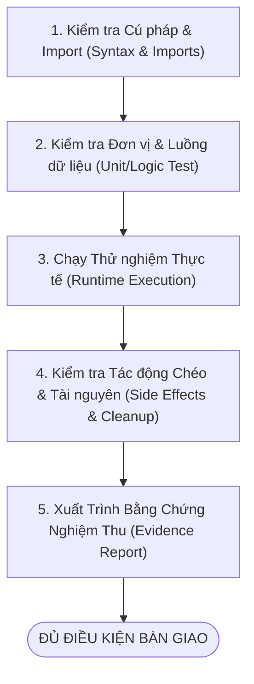

# QUY TẮC PHÁT TRIỂN & BÀN GIAO: BẮT BUỘC KIỂM THỬ THỰC TẾ
*(Mã tài liệu: `RULE.md` - Áp dụng nghiêm ngặt cho tất cả Agent & Developer)*

---

## 1. NGUYÊN TẮC TỐI THƯỢNG (THE CARDINAL RULE)

> [!CAUTION]
> **KHÔNG KIỂM THỬ = KHÔNG BÀN GIAO (NO TEST = NO DELIVERY)**
> 
> Mọi Agent tham gia phát triển dự án **TUYỆT ĐỐI KHÔNG ĐƯỢC PHÉP** báo cáo "Đã hoàn thành", "Đã sửa xong", hoặc bàn giao thành phẩm cho người dùng khi **CHƯA THỰC SỰ CHẠY KIỂM THỬ VÀ CÓ BẰNG CHỨNG THỰC THI THỰC TẾ**.

- **Không bao giờ suy đoán:** Nghiêm cấm mọi giả định kiểu *"Code nhìn có vẻ đúng rồi nên chắc chắn chạy được"*, *"Logic này đơn giản nên không thể lỗi"*.
- **Code viết xong chỉ là bản nháp:** Mã nguồn chỉ được xem là hợp lệ sau khi đã được thông dịch/biên dịch và vượt qua các kịch bản kiểm thử runtime thành công (`Exit Code = 0`).
- **Nói có sách, mách có chứng:** Mọi lời khẳng định hoàn thành đều **bắt buộc** phải đi kèm nhật ký lệnh (Terminal Output / Test Logs) chứng minh mã nguồn đã thực sự chạy qua.

---

## 2. TIÊU CHUẨN HOÀN THÀNH (DEFINITION OF DONE - DoD)

Một nhiệm vụ, tính năng mới hoặc bản sửa lỗi (bugfix) chỉ được công nhận là **HOÀN THÀNH (DONE)** khi thỏa mãn đầy đủ 5 điều kiện sau:



1. **Syntax & Static Check:** Không có lỗi cú pháp, không import thiếu thư viện, không sót biến chưa định nghĩa (`NameError`).
2. **Logic & Functional Test:** Tính năng thực hiện chính xác yêu cầu, xử lý đúng cả trường hợp dữ liệu hợp lệ (Happy Path) lẫn dữ liệu biên/ngoại lệ (Edge Cases).
3. **Runtime Execution:** File mã nguồn hoặc kịch bản kiểm thử đã được chạy trực tiếp bằng Python trên môi trường hiện tại và không sinh ra ngoại lệ chưa bắt (Unhandled Exceptions).
4. **Side Effects & Cleanup Check:** 
   - Không gây lỗi hồi quy (regression) làm hỏng các module phụ thuộc.
   - Đảm bảo giải phóng tài nguyên sau khi test: Đóng kết nối CSDL, đóng trình duyệt WebDriver, dọn dẹp các thư mục profile tạm thời.
5. **Evidence Provided:** Trích dẫn rõ ràng output thực tế của lệnh kiểm thử trong phản hồi gửi đến người dùng.

---

## 3. QUY TRÌNH KIỂM THỬ BẮT BUỘC THEO 4 CẤP ĐỘ

Mỗi khi tạo mới hoặc chỉnh sửa mã nguồn, Agent phải tuần tự thực hiện các cấp độ kiểm thử sau:

### Cấp độ 1: Kiểm tra Cú pháp & Tải tĩnh (Static & Compilation Check)
Trước khi làm bất cứ điều gì, phải xác minh Python biên dịch được file mà không gặp lỗi cú pháp:
```powershell
# Bắt buộc chạy kiểm tra cú pháp
python -m py_compile <đường_dẫn_file.py>
```
Nếu lệnh trả về mã lỗi khác 0, **dừng lại ngay lập tức và sửa lỗi cú pháp trước**.

---

### Cấp độ 2: Kiểm tra Đơn vị & Logic nghiệp vụ (Unit & Logic Tests)
Tạo tệp test độc lập trong thư mục `tests/` hoặc thư mục nháp `scratch/` để kiểm tra từng hàm/lớp:
- **Kiểm tra đầu vào - đầu ra:** Truyền các tham số mẫu và kiểm tra giá trị trả về (`assert`).
- **Kiểm tra xử lý lỗi (Exception Handling):** Kiểm tra mã nguồn ứng xử ra sao khi đầu vào là `None`, chuỗi rỗng `""`, file không tồn tại, JSON sai định dạng.
- **Nghiêm cấm viết test giả tạo:** Tuyệt đối không viết `assert True`, không dùng khối `except: pass` để nuốt lỗi trong test script. Test phải kiểm tra logic nghiệp vụ thực tế.

---

### Cấp độ 3: Kiểm tra Khởi tạo & Tương thích Môi trường (Integration & Sanity Check)
- **Đối với module giao diện (GUI):**
  - Khởi tạo instance giao diện ngầm và kiểm tra không bị crash khi load các widget:
    ```powershell
    python -c "from clean_app.gui_app import FBAutoPostGUI; print('GUI Class Imported Successfully')"
    ```
- **Đối với module CSDL / Model:**
  - Tạo CSDL thử nghiệm (in-memory hoặc file tạm), thực hiện CRUD (Tạo, Đọc, Sửa, Xóa), đóng kết nối và kiểm tra tính toàn vẹn dữ liệu.
- **Đối với module Selenium / Tự động hóa:**
  - Khởi tạo Service và Chrome Options ở chế độ headless.
  - Đảm bảo `driver.quit()` được gọi đầy đủ và thư mục `tempfile` được dọn sạch.

---

### Cấp độ 4: Kiểm tra Lỗi Ngầm & Nhật ký Ẩn (Hidden Crashes Inspection)
Rất nhiều lỗi trong ứng dụng Desktop / Selenium không hiện ra console mà âm thầm ghi vào file log hoặc nuốt lỗi:
- Bắt buộc kiểm tra file nhật ký crash (nếu có cấu hình, ví dụ `%APPDATA%\ToolFacebook\crash.log`).
- Xác nhận sau khi test không phát sinh thêm bất kỳ dòng crash/traceback mới nào trong các file log hệ thống.

---

## 4. BẢNG TIÊU CHÍ KIỂM THỬ ĐẶC THÙ CHO "CAPPYAUTOPAST"

Khi phát triển các thành phần của công cụ **CappyAutoPost**, Agent bắt buộc phải test các hạng mục nghiệp vụ sau trước khi giao:

| Module / Tính năng | Kịch bản Bắt buộc phải Test | Tiêu chí Nghiệm thu (Pass Criteria) |
| :--- | :--- | :--- |
| **Module Cookie Parser** | Nạp chuỗi `c_user=...; xs=...`, chuỗi có chứa ký tự `\|`, mảng JSON từ Extension, chuỗi rỗng. | Phân tách đủ 100% cookie key-value, không bị sót, không crash khi gặp định dạng lạ. |
| **Module Spintax & Var** | Chuỗi lồng nhau `{A\|{B1\|B2}}`, các biến `{time}`, `{date}`, `{rand_id}`. | Sinh ra chuỗi ngẫu nhiên đúng cấu trúc, không còn sót dấu ngoặc nhọn `{}` chưa giải mã. |
| **Module SQLite DB** | Thêm mới tài khoản, cập nhật trạng thái Live/Die, truy vấn danh sách nhóm theo tag, ghi lịch sử post. | Ghi thành công vào CSDL, không bị khóa file (`database is locked`), kiểu dữ liệu chuẩn xác. |
| **Module Anti-Detection** | Khởi chạy Chrome Headless với cờ anti-bot và thực hiện lệnh kiểm tra Javascript. | Thuộc tính `navigator.webdriver` trả về `undefined`, không xuất hiện cờ tự động hóa. |
| **Module Đa tiến trình (MP)**| Gửi tín hiệu dừng (`stop_event.set()`), truyền log màu qua `Queue`. | Tiến trình con dừng ngay lập tức, giải phóng RAM, GUI không bị treo đơ (freeze). |

---

## 5. NHỮNG ĐIỀU NGHIÊM CẤM (STRICT PROHIBITIONS)

1. ❌ **CẤM:** Viết code xong rồi trả lời người dùng: *"Tôi đã viết xong code cho bạn, bạn hãy chạy thử nhé"*. Người chạy thử đầu tiên **PHẢI LÀ AGENT**.
2. ❌ **CẤM:** Chạy lệnh test thấy lỗi nhưng vẫn cố tình giải thích vòng vo hoặc bỏ qua lỗi để nộp bài. Khi test lỗi, **bắt buộc phải đọc traceback, sửa triệt để và test lại**.
3. ❌ **CẤM:** Bỏ qua các cảnh báo nghiêm trọng (Warnings về Deprecation, ResourceLeak, Unclosed Sockets).
4. ❌ **CẤM:** Sửa code test để test pass thay vì sửa code chính (Che giấu lỗi nghiệp vụ).

---

## 6. MẪU BÁO CÁO NGHIỆM THU KIỂM THỬ (DELIVERY REPORT FORMAT)

Khi hoàn thành bất kỳ tính năng hay sửa lỗi nào, Agent phải đính kèm phần báo cáo nghiệm thu theo cấu trúc chuẩn sau vào phản hồi:

```markdown
### 📋 BÁO CÁO NGHIỆM THU KIỂM THỬ (VERIFICATION EVIDENCE)

1. **Các kịch bản đã kiểm thử:**
   - [x] Kịch bản 1: Kiểm tra cú pháp và import toàn bộ module.
   - [x] Kịch bản 2: Kiểm thử hàm `parse_cookie` với 3 định dạng chuỗi khác nhau.
   - [x] Kịch bản 3: Chạy thử nghiệm thực tế (Dry-run) luồng chính.

2. **Lệnh thực thi & Kết quả thực tế:**
   ```powershell
   # Lệnh đã chạy:
   python tests/test_cookie_parser.py
   
   # Kết quả trả về (Trích xuất nguyên văn từ terminal):
   [✓] Test Case 1: Standard String -> PASSED (5 cookies parsed)
   [✓] Test Case 2: JSON Export -> PASSED (8 cookies parsed)
   [✓] Test Case 3: Malformed String -> Handled Safely without crash
   Ran 3 tests in 0.045s - OK (Exit code: 0)
   ```

3. **Kết luận:** Mã nguồn hoạt động chính xác 100%, không phát sinh tác dụng phụ, đủ điều kiện bàn giao.
```

---

## 7. HIỆU LỰC THI HÀNH

- Quy tắc này có hiệu lực **ngay lập tức** và **xuyên suốt** vòng đời dự án.
- Mọi Agent tiếp nhận lượt trao đổi tiếp theo đều phải tuân thủ nghiêm ngặt theo tài liệu này. Không có bất kỳ ngoại lệ nào.
